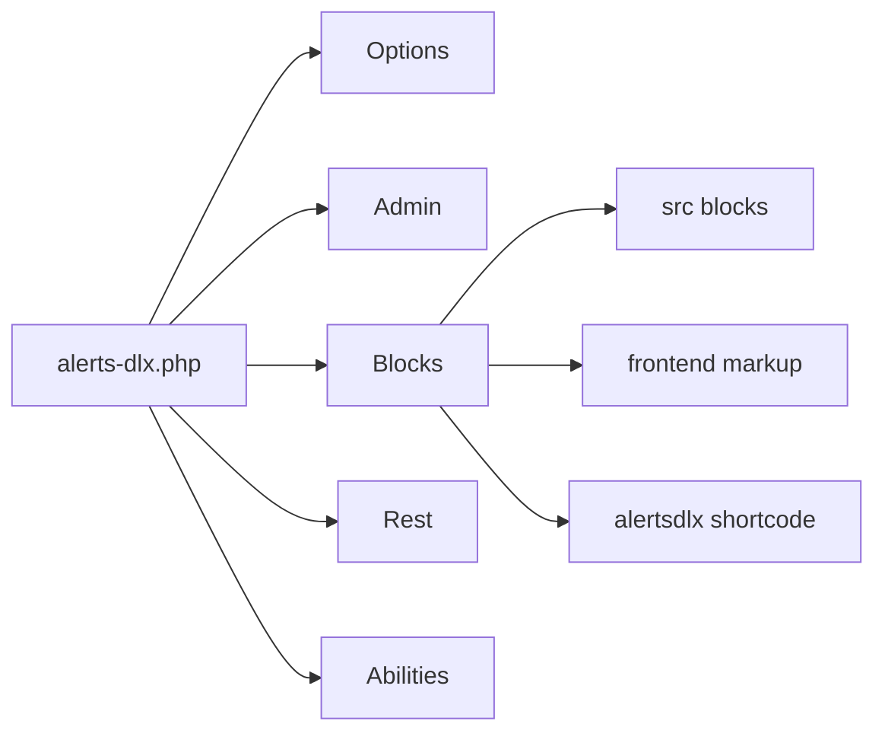

# Architecture

How AlertsDLX boots, renders alerts, and stores settings. Keep this file accurate when you change those flows.

## Runtime bootstrap



1. WordPress loads `alerts-dlx.php`.
2. Composer autoload (`lib/autoload.php`) maps `DLXPlugins\AlertsDLX\` → `php/`.
3. On `plugins_loaded`, `AlertsDLX::plugins_loaded()` starts:
   - `Options::run()` — reserved for migrations; options are read via `Options::get_plugin_options()`.
   - `AlertLibrary::run()` — Private `alerts_dlx_library` CPT for global styles and snapshots.
   - `Admin::run()` — Settings screen and AJAX save/retrieve/reset.
   - `Blocks::run()` — Block registration, editor/frontend assets, shortcode.
   - `Rest::run()` — REST search for the button URL picker and alert library CRUD.
   - `Abilities::run()` — Abilities API category, `[alertsdlx]` shortcode generator, and saved global-style list, when WordPress provides `wp_register_ability`.
4. Fires `do_action( 'alerts_dlx_loaded' )` for extenders.

A custom content pipeline `alerts_dlx_the_content` (embed, autop, shortcodes) processes alert description content without relying solely on `the_content`.

## PHP classes (`php/`)

| Class | Responsibility |
|-------|----------------|
| `Options` | Defaults, allowlists, get/sanitize/save for option key `alerts_dlx` |
| `Admin` | Settings → AlertsDLX menu, enqueue admin React app, AJAX handlers |
| `Blocks` | Register blocks from `build/`, render callback, shortcode, asset enqueue |
| `AlertLibrary` | CPT `alerts_dlx_library`, meta `_alerts_dlx_kind`, config JSON in `post_content`, kind-aware sanitize |
| `Rest` | `search/pages` and `library-items` REST routes |
| `ShortcodeBuilder` | Shortcode builder AJAX; global style and snapshot field allowlists |
| `Abilities` | Abilities API: `singular-alerts/generate-alert-shortcode` returns a sanitized `[alertsdlx]` shortcode; `singular-alerts/get-global-styles` returns saved global styles |
| `Functions` | Paths, URLs, capability helpers, shared utilities |

### Options storage

Option name: `alerts_dlx`.

Defaults (see `Options::get_defaults()`):

- `headline_style` — `h1`–`h6` or `div` (allowlisted)
- `headline_custom_classes` — extra classes on titles
- `headline_force_size` — boolean
- `debug_mode` — boolean
- `options_version` — string for future migrations

### Blocks and shortcode

Block names (stable — do not rename lightly):

- `mediaron/alerts-dlx-alert` (canonical; goal-first inserter variations)
- `mediaron/alerts-dlx-bootstrap`
- `mediaron/alerts-dlx-chakra`
- `mediaron/alerts-dlx-material`
- `mediaron/alerts-dlx-shoelace`

Registration uses `build/js/blocks/` + `build/blocks-manifest.php` via `wp_register_block_types_from_metadata_collection` (with fallbacks).

All five blocks share the same PHP render callback: `Blocks::frontend()`. The shortcode `[alertsdlx]` maps attributes into the same markup path via `Blocks::shortcode()`.

### Canonical Alert and the library

The canonical block keeps seven goal-first inserter variations (Info, Success, Warning, Error, Tip, Announcement, Call to Action). Variations use built-in insertion defaults only; there is no site-saved “new alert defaults” store.

The canonical block Styles sidebar exposes these panels, in order:

1. **Global Styles** — collapsed until opened. Hidden when the site has no global styles, unless the block still points at a missing style so **Detach** remains available. The dropdown shows the attached style (or **None**) and only updates a pending selection. **Apply** is not rendered while that selection already matches the attached id, including when both are **None**. When the dropdown differs, **Apply** stores `globalStyleId` (integer; `0` = none). Appearance is resolved from that library item at PHP render and in the editor preview. Title, description, button copy, links, unique ID, and InnerBlocks stay on the block. Appearance controls owned by the style are read-only while attached. **Apply** with **None**, and **Detach**, both copy the resolved appearance onto the block, then clear `globalStyleId`, so the alert does not visually jump. Applying or detaching a style leaves the panel open.
2. **Presets** — public label for snapshots. Collapsed until opened, and hidden when the site has no snapshots. Each preset is a button. Hovering a button shows a popover preview of the current alert with that snapshot's appearance applied. Clicking a button immediately copies the snapshot allowlist onto the block (no live link). Those buttons are replaced with a detach prompt while a global style is attached. Applying a preset clears `globalStyleId` so the copy wins, and the panel stays open. Snapshots do not store title/description/button text. When the current block has not set a title, description, or button label, the popover fills only that missing piece with sample copy. The sample stays in the preview and is not saved onto the block. The in-canvas icon picker is disabled while a global style is attached.
3. **Styles** — alert type control, open by default.
4. The remaining style panels (custom colors, Appearance) follow.

Snapshots may set post meta `_alerts_dlx_show_in_inserter`. Each flagged snapshot is an extra canonical Alert inserter variation that copies attributes and does not stay linked. Global styles are not inserter choices: the control is hidden, reads report the flag as off, and saving a global style clears any stored flag, so a previously flagged global style leaves the inserter immediately. The Styles sidebar remains how a block stays linked to a global style. The seven goal variations remain, and Success stays the variation used when inserting Alert itself. Duplicating a library item does not copy the flag. Library CRUD stays under Settings → AlertsDLX → Styles & Snapshots.

Editor boot localizes `libraryItems` (id, title, slug, kind, config, showInInserter) and `canManageLibrary` on `alertsDlxBlock`. For global styles, `showInInserter` is always false. REST `GET` for library items allows `edit_posts`; create/update/delete remain `manage_options`.

On first `init` when the library has no snapshots yet, two starter snapshots are inserted once (`Maintenance notice`, `Download CTA`), gated by option `alerts_dlx_starter_snapshots_seeded` so deleted starters are never re-created.

### Assets

- **Block editor JS/CSS**: built by `@wordpress/scripts` into `build/` from `src/index.js` and block metadata under `src/js/blocks/`.
- **Theme styles, fonts, dismiss script, admin app**: custom webpack config → `dist/` (entries such as `alerts-dlx-bootstrap-styles`, `alerts-dlx-dismiss`, `alerts-dlx-admin-settings`).
- Frontend loads only styles needed for alerts present on the page (and dismiss JS when close buttons are used).

### Admin settings

- Menu: Settings → AlertsDLX (`settings_page_alerts-dlx`).
- Tabs: **Settings**, **Shortcode Builder**, **Styles & Snapshots** (`tab=styles-snapshots`).
- UI: React apps in `src/react/Settings/`, `src/react/ShortcodeBuilder/`, `src/react/AlertLibrary/` → `dist/alerts-dlx-admin-*.js`.
- Site options persistence: admin-ajax actions `alerts_dlx_retrieve_settings`, `alerts_dlx_save_settings`, `alerts_dlx_reset_settings` (capability `manage_options`, nonces required).

### Alert library (global styles and snapshots)

- Post type: `alerts_dlx_library` (not public; admin-only; supports `title` and `editor` for `post_content`).
- Kind meta: `_alerts_dlx_kind` (`global_style` | `snapshot`). Inserter meta: `_alerts_dlx_show_in_inserter` (snapshots only; saving one snapshot does not clear the flag on others). Global styles do not keep this flag.
- Config store: sanitized JSON in `post_content` (written via `AlertLibrary::encode_config_for_storage()`, which `wp_slash`es the JSON so SVG icons survive WordPress unslash). Old `_alerts_dlx_config` meta is not read.
- Global styles store the appearance allowlist (`ShortcodeBuilder::get_global_style_input_names()`). Snapshots store that set plus `align`, `title_enabled`, `description_enabled`, `button_enabled`, `close_button_enabled`, and `close_button_expiration` (`ShortcodeBuilder::get_snapshot_input_names()`).
- Title/description/button on snapshots are visibility toggles (`title_enabled` / `description_enabled` / `button_enabled`). The shortcode renderer still derives those flags from content; snapshots persist the toggles and preview injects Lorem copy only when a toggle is on.
- Preview uses a fixed Lorem ipsum fixture in the admin UI. Stored snapshot alignment and dismiss values win over the fixture.
- Admin: one **Styles & Snapshots** tab (`#alerts-dlx-library`) lists both kinds; kind is chosen when creating an item and is immutable afterward.
- Slugs are unique **per kind** (`post_name` scoped by `_alerts_dlx_kind`).
- REST: `GET dlxplugins/alerts-dlx/v1/library-items` (`kind` optional; omit or `all` returns both) and `GET .../library-items/{id}` allow `edit_posts`. `POST/PUT/DELETE` and `POST .../duplicate` require `manage_options`.
- Filters: `alerts_dlx_global_style_config` and `alerts_dlx_snapshot_config` when reading library config.
- Frontend: when a block has a valid `globalStyleId`, `AlertLibrary::apply_global_style_to_block_attributes()` merges that global style’s appearance over the block before `AlertRenderer` runs. Invalid/missing/wrong-kind IDs are ignored.

## Frontend / editor JS (`src/`)

```
src/
  index.js                 # Registers all blocks + editor plugins
  js/blocks/
    bootstrap|chakraui|material|shoelace/   # Per-theme block.json + edit.js
    plugins/               # Shared editor chrome (toolbar, colors, icons, etc.)
    components/            # Shared React UI
    utils/                 # Style helpers, transforms, SVG sanitize
  js/dismiss/              # Cookie/session dismiss behavior on the frontend
  react/Settings/          # Admin settings app
  react/AlertLibrary/      # Styles & Snapshots admin app
  scss/                    # common + per-theme stylesheets
```

Chakra’s source folder is named `chakraui/` on disk; the block name and CSS group remain `chakra`.

Shared editor behavior lives in `plugins/` so all themes stay consistent (style toolbar, visibility toggles, close expiration, editorial-only, inner blocks, icon picker).

## Styling contract

Visual appearance is driven by attributes that become CSS classes. Details and examples: [styles.md](../styles.md).

Do not change class patterns or attribute semantics without considering existing content and third-party CSS.

## Dismissible alerts

When a close button is enabled, frontend dismiss JS (`src/js/dismiss`) hides the alert and remembers the choice according to `closeButtonExpiration` (session or timed cookie). High-level user docs live in the docs repo.

## Release artifacts

| Artifact | Audience |
|----------|----------|
| `readme.txt` | WordPress.org (version, FAQ, changelog) |
| `README.md` | GitHub |
| `alerts-dlx.zip` via `npx grunt` | Packaged plugin (PHP, lib, dist, build, assets, readme) |
| [alerts-dlx-docs](https://github.com/MediaRon/alertsdlx-docs) | End-user / developer documentation site |

Source maps and `node_modules` are not part of the Grunt zip.
